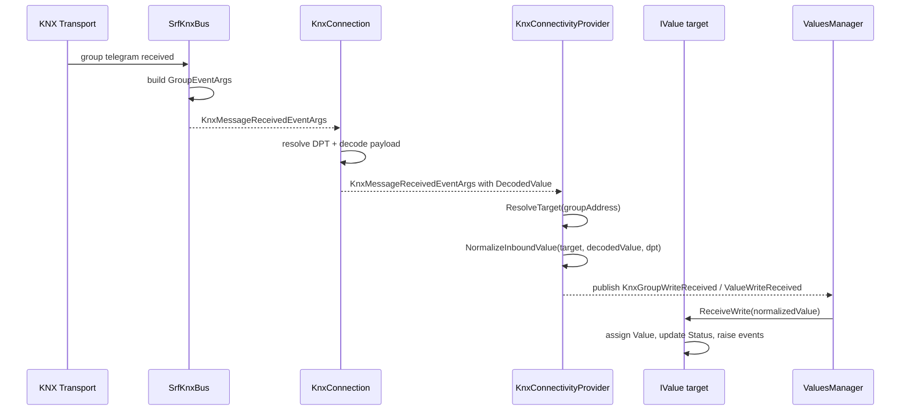

# Architecture Specification: KNX Write Flow to Value Update

**Date:** 2026-10-16
**Status:** Reference / Implementation note
**Owner:** HomeCompanion.Integrations.Knx / HomeCompanion.Values

## Purpose

This document captures the exact runtime path for an inbound KNX write telegram as it moves from the KNX transport layer into the target `IValue` instance and updates the stored value.

This is a focused companion to the broader routing specification in [homecompanion-connectivity-value-routing-arch-spec.md](./homecompanion-connectivity-value-routing-arch-spec.md).

## Scope

This document covers:

- KNX transport receive flow
- DPT decoding and typed payload conversion
- group-address to `IValue` resolution
- inbound normalization for scalar-to-quantity targets
- event publication and routing to `ValueBase<T>`
- final state update on the value object

## Key classes and responsibilities

### 1. Transport layer: bus adapter

- `IKnxBus`
  - Protocol-neutral KNX bus interface.
- `SrfKnxBus`
  - Concrete adapter that listens to the underlying KNX transport and converts vendor events into the HomeCompanion KNX message model.
  - In `OnGroupMessageReceived(...)`, it creates `GroupEventArgs` and raises `MessageReceived` with a `KnxMessageReceivedEventArgs`.

### 2. Connection layer: KNX message decoding

- `KnxConnection`
  - Connects an `IKnxBus` to the app-level KNX integration.
  - Subscribes to bus messages and calls `OnBusMessageReceived(...)`.
  - Resolves the DPT via `IDptResolver.GetDpt(...)`.
  - Decodes the raw payload with `dpt.ToValue(...)`.
  - Stores the result in `KnxMessageContext.DecodedValue`.

### 3. Provider layer: mapping and normalization

- `KnxBusEndpointMapping`
  - The bus-specific mapping attached to an `IValue` via `IValue.BusMappings`.
  - Owns KNX-specific configuration, including the DPT identifier and any bus-endpoint conversion metadata needed for protocol-aware normalization.
  - Is the preferred location for KNX conversion logic that depends on DPT, `KnxUnit`, or group-address semantics.
- `KnxConnectivityProvider`
  - Owns the KNX-to-value mapping dictionary built from discovered `IValue` instances with `KnxBusEndpointMapping`.
  - Handles inbound telegram processing in `OnMessageReceived(...)`.
  - Resolves the destination group address to a target `IValue`.
  - Calls `NormalizeInboundValue(...)` to adapt the decoded payload to the target value type.
  - Uses the mapping/provider-specific normalization path before falling back to generic value parsing.
  - Publishes `KnxGroupWriteReceived` to the HomeCompanion event bus.

### 4. Event model: value-level write notification

- `KnxGroupWriteReceived`
  - Event published by the KNX provider for a received bus write.
  - Carries:
    - `DestinationAddress`
    - `SourceAddress`
    - `RawValue`
    - `DecodedValue`
    - `Target`
    - `Value` (normalized value)
- `ValueWriteReceived`
  - Shared event base used by the event bus for inbound writes.
  - Contains the `Target` and the actual `Value` payload.

### 5. Routing layer: target dispatch

- `ValuesManager`
  - Subscribes to `ValueWriteReceived` events.
  - Validates target registration and lifecycle state.
  - Executes `receiver.ReceiveWrite(@event.Value)` for the correct value instance.

### 6. Value layer: final state update

- `IValueEventReceiver`
  - Contract implemented by value instances so they can receive routed updates.
- `ValueBase<T>`
  - Implements `ReceiveWriteCore(...)`.
  - Verifies the incoming object is compatible with `T`.
  - Assigns the new value to the backing field.
  - Updates the lifecycle status and emits value-change events.

## Runtime path

### Step 1: telegram arrives from the KNX bus

The underlying KNX implementation raises a group message event.

In the Falcon adapter, this happens in `SrfKnxBus.OnGroupMessageReceived(...)`:

- vendor event is mapped to `GroupEventArgs`
- source and destination addresses are created
- raw `GroupValue` is carried forward
- `MessageReceived` is raised with `KnxMessageReceivedEventArgs`

### Step 2: `KnxConnection` decodes it into a typed value

`KnxConnection.OnBusMessageReceived(...)` receives that event and does the protocol-specific decode.

It performs:

1. look up the DPT from the group address (`_dptResolver.GetDpt(...)`)
2. assign the DPT to `KnxMessageContext.Dpt`
3. decode the raw payload with `dpt.ToValue(...)`
4. store the resulting object in `KnxMessageContext.DecodedValue`
5. raise the event to all subscribers

This is the first time the app sees a meaningful object-level representation of the payload.

### Step 3: `KnxConnectivityProvider` resolves the target value

In `KnxConnectivityProvider.OnMessageReceived(...)`:

1. extracts the `GroupEventArgs`
2. looks up the target value by destination address with `ResolveTarget(args.DestinationAddress)`
3. attempts to resolve the DPT again if needed
4. calls `NormalizeInboundValue(target?.Value, ctx.DecodedValue, dpt)`

The `target` is the `IValue` instance registered for that group address.

### Step 4: normalization makes the bus payload compatible with the target value

`NormalizeInboundValue(...)` is the compatibility layer, but it is not the primary authority for conversion logic. The primary authority is the bus mapping and provider for the protocol in question.

The intended precedence is:

1. bus-specific conversion owned by the endpoint mapping / provider (`KnxBusEndpointMapping`, `KnxConnectivityProvider`)
2. protocol-level normalization based on DPT metadata (`KnxUnit`, DPT application type, group-address semantics)
3. generic value-layer parsing as a defensive fallback (`IValue.TryParseValue(...)`, `ValueBase` conversion helpers)
4. if all attempts fail, log a warning and keep the decoded value as-is

This keeps conversion responsibility with the bus integration where protocol details actually live.

For KNX specifically, the logic handles common mismatches between:

- raw scalar values (for example `float`, `int`, `Single`)
- quantity-backed values (for example `UnitsNet.Illuminance`, `Temperature`, etc.)
- DPT metadata carrying unit information (`KnxUnit`, DPT application type)

The provider first asks the `KnxBusEndpointMapping` whether it can normalize the value using bus metadata. Only if that fails does the generic numeric/quantity fallback run. This is the intended hierarchy and is the main architectural rule to preserve.

### Step 5: provider publishes a value-level event

When the event type is `GroupEventType.ValueWrite`, the provider publishes:

- `KnxGroupWriteReceived`

This event extends `ValueWriteReceived`, which carries:

- `Target`
- `Value` (normalized value)
- raw and decoded bus payload details

This event is the app-level representation of the KNX write.

### Step 6: `ValuesManager` routes the event to the target `IValue`

The `ValuesManager` route path is:

1. receive `ValueWriteReceived`
2. check lifecycle gating
3. ensure target is non-null
4. ensure target is registered
5. ensure target implements `IValueEventReceiver`
6. call `receiver.ReceiveWrite(@event.Value)`

This decouples the protocol integration from the actual value implementation.

### Step 7: `ValueBase<T>` applies the value to state

`ValueBase<T>.ReceiveWriteCore(...)` performs the final update:

- rejects null
- checks the object is compatible with `T`
- assigns `Value = typed`
- sets `Status` to initialized/live
- publishes `ValueWritten<T>` and `ValueChanged<T>` events if appropriate

A value is now updated in memory and can trigger downstream logic, UI updates, persistence, and automation.

## Sequence diagram

## Important design point

The KNX connector does not directly mutate the final value object, and the value layer should not be the primary owner of protocol-specific conversion.

The intended layered model is:

1. bus payload to DPT-decoded object (`KnxConnection` / DPT resolver)
2. decoded object to app-compatible type using bus metadata owned by the endpoint mapping/provider (`KnxBusEndpointMapping` / `KnxConnectivityProvider`)
3. routed event to final `ValueBase<T>` assignment

`ValueBase` conversion logic remains a defensive fallback only. It exists to handle cases where a generic scalar reaches a quantity target without explicit bus metadata, but it is not the preferred or authoritative conversion path for KNX values.

This separation keeps the bus layer transport-aware and preserves a clear ownership boundary: bus-specific conversion belongs to the bus mapping/connector, while generic state assignment and validation remain in the value layer.

## Related documents

- [homecompanion-connectivity-value-routing-arch-spec.md](./homecompanion-connectivity-value-routing-arch-spec.md)
- [homecompanion-mqtt-connectivity-provider-arch-spec.md](./homecompanion-mqtt-connectivity-provider-arch-spec.md)
- [README](../../README.md)
